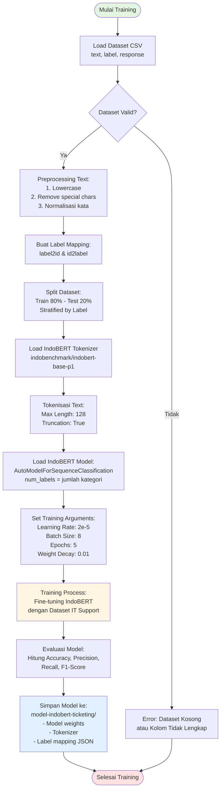
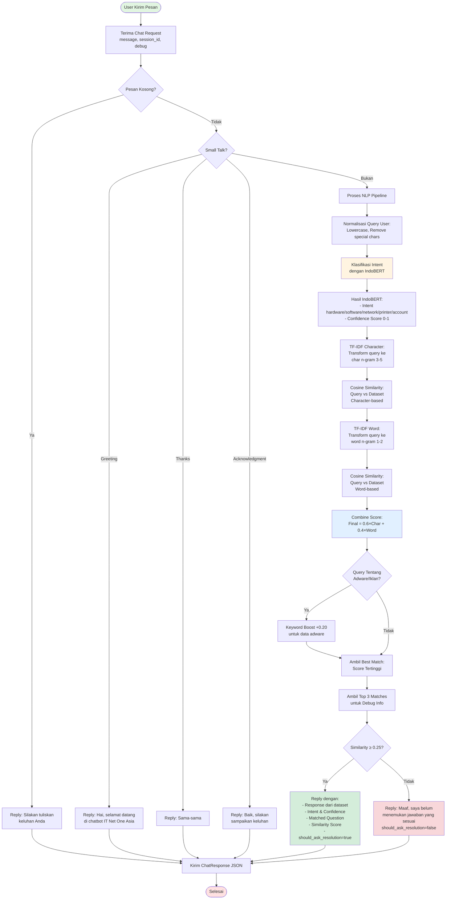

# Flowchart Sistem Chatbot IT Support - IndoBERT + TF-IDF Retrieval

## 1. Flowchart Training Model IndoBERT



## 2. Flowchart Preprocessing & Feature Extraction (TF-IDF)

```mermaid
flowchart TD
    Start([Mulai Preprocessing]) --> LoadDataset[Load Dataset CSV<br/>143+ rows]
    LoadDataset --> NormalizeLoop[Loop Setiap Pertanyaan]
    
    NormalizeLoop --> NormText[Normalisasi Text:<br/>1. Lowercase<br/>2. Replace kata informal<br/>nggak→tidak, gak→tidak<br/>nyala→menyala]
    
    NormText --> RemoveSpecial[Remove Special Characters:<br/>Regex: [^a-z0-9\s]]
    RemoveSpecial --> RemoveSpace[Remove Extra Spaces:<br/>Multiple spaces → Single space]
    
    RemoveSpace --> Augmentation{Perlu Augmentasi?}
    Augmentation -->|Ya - Adware| AugAdware[Tambah 5 Variasi<br/>Pertanyaan Adware]
    Augmentation -->|Ya - Password| AugPassword[Tambah 5 Variasi<br/>Pertanyaan Password Reset]
    Augmentation -->|Ya - Printer| AugPrinter[Tambah 5 Variasi<br/>Pertanyaan Install Printer]
    Augmentation -->|Tidak| NextRow[Lanjut ke Row Berikutnya]
    
    AugAdware --> NextRow
    AugPassword --> NextRow
    AugPrinter --> NextRow
    
    NextRow --> AllDone{Semua Data<br/>Selesai?}
    AllDone -->|Belum| NormalizeLoop
    AllDone -->|Ya| CreateVectorizer[Buat TF-IDF Vectorizer:<br/>1. Character n-gram 3-5<br/>2. Word n-gram 1-2]
    
    CreateVectorizer --> FitTransform[Fit & Transform:<br/>Dataset → TF-IDF Vectors]
    FitTransform --> StoreVectors[Simpan di Memory:<br/>char_dataset_vectors<br/>word_dataset_vectors]
    
    StoreVectors --> End([Preprocessing Selesai])
    
    style Start fill:#e1f5e1
    style End fill:#e1f0ff
    style CreateVectorizer fill:#fff4e1
```

## 3. Flowchart Inference - Proses Chat Request



## 4. Flowchart Detail Algoritma IndoBERT Classification

```mermaid
flowchart TD
    Start([Input Text Query]) --> Tokenize[Tokenisasi dengan<br/>IndoBERT Tokenizer]
    Tokenize --> AddSpecial[Tambah Special Tokens:<br/>CLS di awal<br/>SEP di akhir]
    
    AddSpecial --> ConvertID[Convert Token ke<br/>Input IDs]
    ConvertID --> CreateMask[Buat Attention Mask:<br/>1 = token asli<br/>0 = padding]
    
    CreateMask --> EmbedLayer[Embedding Layer:<br/>Token → Vector 768 dimensi]
    EmbedLayer --> TransformerLayer[12 Transformer Layers:<br/>Self-Attention + Feed Forward]
    
    TransformerLayer --> SelfAttention[Multi-Head Self-Attention:<br/>Query, Key, Value<br/>8 attention heads]
    SelfAttention --> AddNorm1[Add & Normalize]
    
    AddNorm1 --> FeedForward[Feed Forward Network:<br/>768 → 3072 → 768]
    FeedForward --> AddNorm2[Add & Normalize]
    
    AddNorm2 --> NextLayer{Layer ke-12?}
    NextLayer -->|Belum| TransformerLayer
    NextLayer -->|Ya| CLSToken[Ambil CLS Token Output:<br/>Representasi Kalimat]
    
    CLSToken --> Dropout[Dropout Layer:<br/>Regularisasi]
    Dropout --> Dense[Dense Layer:<br/>768 → num_labels<br/>Linear Transformation]
    
    Dense --> Softmax[Softmax Activation:<br/>Convert ke Probabilitas]
    Softmax --> GetLabel[Ambil Label dengan<br/>Probabilitas Tertinggi]
    
    GetLabel --> Output[Output:<br/>- Label hardware/software/network/printer/account<br/>- Confidence Score]
    Output --> End([Selesai Klasifikasi])
    
    style Start fill:#e1f5e1
    style End fill:#ffe1e1
    style TransformerLayer fill:#fff4e1
    style Softmax fill:#e1f0ff
```



## 5. Flowchart TF-IDF Hybrid Retrieval

```mermaid
flowchart TD
    Start([Query User Masuk]) --> Normalize[Normalisasi Query]
    Normalize --> CharVectorizer[TF-IDF Character Vectorizer:<br/>analyzer=char_wb<br/>ngram_range 3-5]
    
    CharVectorizer --> CharTransform[Transform Query ke<br/>Character N-gram Vector]
    CharTransform --> CharCosine[Cosine Similarity:<br/>Query Vector vs<br/>143+ Dataset Vectors]
    
    CharCosine --> CharScores[Dapat Character Scores<br/>untuk semua dataset]
    CharScores --> WordVectorizer[TF-IDF Word Vectorizer:<br/>analyzer=word<br/>ngram_range 1-2]
    
    WordVectorizer --> WordTransform[Transform Query ke<br/>Word N-gram Vector]
    WordTransform --> WordCosine[Cosine Similarity:<br/>Query Vector vs<br/>Dataset Vectors]
    
    WordCosine --> WordScores[Dapat Word Scores<br/>untuk semua dataset]
    WordScores --> Combine[Kombinasi Score:<br/>Final = 0.6 × CharScore<br/>+ 0.4 × WordScore]
    
    Combine --> CheckKeyword{Keyword Adware<br/>di Query?}
    CheckKeyword -->|Ya| LoopDataset[Loop Dataset]
    CheckKeyword -->|Tidak| FindMax
    
    LoopDataset --> CheckDataAdware{Data Mengandung<br/>Keyword Adware?}
    CheckDataAdware -->|Ya| Boost[Boost Score +0.20<br/>Max score = 1.0]
    CheckDataAdware -->|Tidak| NextData[Data Berikutnya]
    
    Boost --> NextData
    NextData --> AllChecked{Semua Data<br/>Dicek?}
    AllChecked -->|Belum| CheckDataAdware
    AllChecked -->|Ya| FindMax[Cari Index dengan<br/>Score Maksimum]
    
    FindMax --> GetBest[Ambil Best Match:<br/>- Question<br/>- Label<br/>- Response<br/>- Similarity Score]
    
    GetBest --> SortScores[Sort Scores Descending]
    SortScores --> GetTop3[Ambil Top 3 Matches<br/>untuk Debug]
    
    GetTop3 --> Return[Return:<br/>- best_text<br/>- best_label<br/>- best_response<br/>- similarity_score<br/>- top_matches]
    
    Return --> End([Selesai Retrieval])
    
    style Start fill:#e1f5e1
    style End fill:#ffe1e1
    style Combine fill:#fff4e1
    style Return fill:#e1f0ff
```



## 6. Flowchart Sistem Lengkap (End-to-End)

```mermaid
flowchart TD
    Start([User Akses Web Chatbot]) --> Landing[Halaman Landing Page]
    Landing --> ClickChat[Klik Tombol Chat]
    ClickChat --> OpenChat[Buka Interface Chatbot]
    
    OpenChat --> TypeMsg[User Ketik Pesan]
    TypeMsg --> SendMsg[Kirim POST /chat API]
    
    SendMsg --> APIReceive[FastAPI Menerima Request]
    APIReceive --> Validate[Validasi Request:<br/>message tidak kosong]
    
    Validate --> SmallTalkCheck{Small Talk?}
    SmallTalkCheck -->|Ya| ResponseDirect[Response Langsung<br/>Tanpa NLP]
    SmallTalkCheck -->|Tidak| NLPProcess[Proses NLP]
    
    NLPProcess --> Parallel{Parallel Processing}
    
    Parallel --> Process1[Path 1: IndoBERT]
    Parallel --> Process2[Path 2: TF-IDF Retrieval]
    
    Process1 --> Tokenize[Tokenisasi Text]
    Tokenize --> BERTForward[Forward Pass IndoBERT<br/>12 Transformer Layers]
    BERTForward --> Classify[Klasifikasi Intent]
    Classify --> IntentResult[Intent + Confidence]
    
    Process2 --> NormalizeText[Normalisasi Query]
    NormalizeText --> TFIDFChar[TF-IDF Character]
    TFIDFChar --> TFIDFWord[TF-IDF Word]
    TFIDFWord --> HybridScore[Hybrid Scoring 60:40]
    HybridScore --> KeywordBoost[Keyword Boost Adware]
    KeywordBoost --> BestMatch[Best Match + Top 3]
    
    IntentResult --> Merge[Merge Results]
    BestMatch --> Merge
    
    Merge --> ThresholdCheck{Similarity ≥ 0.25?}
    ThresholdCheck -->|Ya| BuildResponse[Build ChatResponse:<br/>- success: true<br/>- reply: response dari dataset<br/>- intent: dari IndoBERT<br/>- confidence: score IndoBERT<br/>- matched_question<br/>- retrieval_label<br/>- similarity<br/>- top_matches<br/>- should_ask_resolution: true]
    
    ThresholdCheck -->|Tidak| BuildNotFound[Build ChatResponse:<br/>- success: true<br/>- reply: Tidak menemukan jawaban<br/>- intent & confidence<br/>- should_ask_resolution: false]
    
    ResponseDirect --> SendToUser
    BuildResponse --> SendToUser[Kirim Response ke Frontend]
    BuildNotFound --> SendToUser
    
    SendToUser --> DisplayChat[Tampilkan di Chat Interface]
    DisplayChat --> ShowDebug{Debug Mode ON?}
    
    ShowDebug -->|Ya| ShowDetail[Tampilkan:<br/>- Intent & Confidence<br/>- Matched Question<br/>- Similarity Score<br/>- Top 3 Matches]
    ShowDebug -->|Tidak| ShowReply[Tampilkan Reply Saja]
    
    ShowDetail --> CheckResolution
    ShowReply --> CheckResolution{should_ask_resolution?}
    
    CheckResolution -->|Ya| AskButton[Tampilkan Tombol:<br/>Sudah / Belum Teratasi]
    CheckResolution -->|Tidak| WaitNext[Tunggu Input User Berikutnya]
    
    AskButton --> UserClick{User Click Button?}
    UserClick -->|Sudah| CloseTicket[Laravel: Catat Selesai<br/>Tidak Buat Tiket]
    UserClick -->|Belum| CreateTicket[Laravel: Buat Tiket IT<br/>- Kategori dari intent<br/>- Detail dari query<br/>- Status: Open]
    
    CloseTicket --> ThankYou[Tampilkan: Terima kasih]
    CreateTicket --> ShowTicket[Tampilkan Nomor Tiket]
    
    ThankYou --> NewChat{Chat Lagi?}
    ShowTicket --> NewChat
    WaitNext --> NewChat
    
    NewChat -->|Ya| TypeMsg
    NewChat -->|Tidak| End([Selesai])
    
    style Start fill:#e1f5e1
    style End fill:#ffe1e1
    style NLPProcess fill:#fff4e1
    style BuildResponse fill:#d4edda
    style CreateTicket fill:#f8d7da
```



## 7. Flowchart Data Augmentation

```mermaid
flowchart TD
    Start([Mulai Augmentasi]) --> LoadOriginal[Load Dataset Original<br/>143 rows]
    LoadOriginal --> CreateSet[Buat Set Pertanyaan<br/>yang Sudah Ada]
    
    CreateSet --> CheckAdware{Cari Reference Row<br/>Adware/Iklan?}
    CheckAdware -->|Ditemukan| AddAdware[Tambah 5 Variasi:<br/>1. aplikasi banyak iklan<br/>2. iklan muncul terus di komputer<br/>3. banyak pop up iklan muncul sendiri<br/>4. komputer muncul iklan terus<br/>5. browser tidak dibuka tapi muncul iklan]
    CheckAdware -->|Tidak| CheckPassword
    
    AddAdware --> NormalizeAdware[Normalisasi Setiap Variasi]
    NormalizeAdware --> CheckDupAdware{Sudah Ada<br/>di Dataset?}
    CheckDupAdware -->|Ya| SkipAdware[Skip Variasi Ini]
    CheckDupAdware -->|Tidak| InsertAdware[Insert ke Dataset:<br/>- text: variasi pertanyaan<br/>- label: software<br/>- response: dari reference<br/>- augmented: true]
    
    SkipAdware --> NextAdware{Semua Variasi<br/>Adware Selesai?}
    InsertAdware --> NextAdware
    NextAdware -->|Belum| NormalizeAdware
    NextAdware -->|Ya| CheckPassword
    
    CheckPassword{Cari Reference Row<br/>Password Reset?}
    CheckPassword -->|Ditemukan| AddPassword[Tambah 5 Variasi:<br/>1. bagaimana cara reset password<br/>2. cara reset password windows<br/>3. saya lupa password windows<br/>4. password akun windows lupa<br/>5. minta bantuan reset password]
    CheckPassword -->|Tidak| CheckPrinter
    
    AddPassword --> NormalizePassword[Normalisasi Setiap Variasi]
    NormalizePassword --> CheckDupPassword{Sudah Ada<br/>di Dataset?}
    CheckDupPassword -->|Ya| SkipPassword[Skip Variasi Ini]
    CheckDupPassword -->|Tidak| InsertPassword[Insert ke Dataset:<br/>- text: variasi pertanyaan<br/>- label: software<br/>- response: dari reference<br/>- augmented: true]
    
    SkipPassword --> NextPassword{Semua Variasi<br/>Password Selesai?}
    InsertPassword --> NextPassword
    NextPassword -->|Belum| NormalizePassword
    NextPassword -->|Ya| CheckPrinter
    
    CheckPrinter{Cari Reference Row<br/>Install Printer?}
    CheckPrinter -->|Ditemukan| AddPrinter[Tambah 5 Variasi:<br/>1. bagaimana instalasi printer<br/>2. cara install printer<br/>3. cara instal printer<br/>4. cara pasang driver printer<br/>5. printer belum terinstal]
    CheckPrinter -->|Tidak| CountFinal
    
    AddPrinter --> NormalizePrinter[Normalisasi Setiap Variasi]
    NormalizePrinter --> CheckDupPrinter{Sudah Ada<br/>di Dataset?}
    CheckDupPrinter -->|Ya| SkipPrinter[Skip Variasi Ini]
    CheckDupPrinter -->|Tidak| InsertPrinter[Insert ke Dataset:<br/>- text: variasi pertanyaan<br/>- label: hardware<br/>- response: dari reference<br/>- augmented: true]
    
    SkipPrinter --> NextPrinter{Semua Variasi<br/>Printer Selesai?}
    InsertPrinter --> NextPrinter
    NextPrinter -->|Belum| NormalizePrinter
    NextPrinter -->|Ya| CountFinal
    
    CountFinal[Hitung Total Dataset:<br/>Original + Augmented]
    CountFinal --> LogInfo[Log: DatasetRows:<br/>143 original + X augmented]
    
    LogInfo --> End([Dataset Siap Digunakan])
    
    style Start fill:#e1f5e1
    style End fill:#e1f0ff
    style AddAdware fill:#fff4e1
    style AddPassword fill:#fff4e1
    style AddPrinter fill:#fff4e1
```



---

## Penjelasan Detail Setiap Flowchart

### 1. Flowchart Training Model IndoBERT

**Tujuan**: Melatih model IndoBERT untuk mengklasifikasikan keluhan IT Support ke dalam 5 kategori (hardware, software, network, printer, account).

**Proses**:
- **Load Dataset**: Membaca file CSV berisi kolom `text` (pertanyaan), `label` (kategori), dan `response` (jawaban)
- **Validasi**: Memastikan dataset tidak kosong dan memiliki kolom yang lengkap
- **Preprocessing**: Normalisasi text dengan mengubah ke lowercase, menghapus karakter spesial, dan normalisasi kata informal (contoh: "gak" → "tidak", "nggak" → "tidak")
- **Label Mapping**: Membuat pemetaan antara nama kategori (hardware, software, dst) ke ID numerik (0, 1, 2, dst) yang diperlukan untuk training
- **Split Dataset**: Membagi data menjadi 80% training dan 20% testing dengan stratified sampling agar setiap kategori terwakili proporsional
- **Tokenisasi**: Menggunakan IndoBERT Tokenizer untuk mengubah text menjadi token dengan panjang maksimal 128 karakter
- **Load Model**: Memuat model IndoBERT pre-trained dari `indobenchmark/indobert-base-p1` dan menambahkan classification head sesuai jumlah kategori
- **Training**: Fine-tuning model dengan parameter learning rate 2e-5, batch size 8, dan 5 epochs menggunakan Hugging Face Trainer
- **Evaluasi**: Menghitung metrik accuracy, precision, recall, dan F1-score pada test set
- **Save Model**: Menyimpan model weights, tokenizer, dan label mapping ke folder `model-indobert-ticketing`

**Output**: Model terlatih yang siap digunakan untuk klasifikasi intent keluhan IT Support

---

### 2. Flowchart Preprocessing & Feature Extraction (TF-IDF)

**Tujuan**: Mempersiapkan dataset dan membuat feature vectors untuk retrieval berbasis similarity.

**Proses**:
- **Load Dataset**: Membaca 143+ baris data dari CSV
- **Loop Normalisasi**: Untuk setiap pertanyaan, dilakukan normalisasi text:
  - Lowercase: mengubah semua huruf menjadi kecil
  - Replace kata informal: "nggak"→"tidak", "gak"→"tidak", "nyala"→"menyala", dll
  - Remove special characters: hanya menyisakan alphanumeric dan spasi
  - Remove extra spaces: mengganti multiple spaces menjadi single space
- **Augmentasi Data**: Menambahkan variasi pertanyaan untuk meningkatkan coverage:
  - **Adware**: 5 variasi pertanyaan tentang iklan/popup
  - **Password Reset**: 5 variasi pertanyaan tentang lupa password
  - **Printer Install**: 5 variasi pertanyaan tentang instalasi printer
- **Buat TF-IDF Vectorizer**: Membuat dua vectorizer:
  - **Character n-gram (3-5)**: Menangkap similarity di level karakter, baik untuk typo dan variasi penulisan
  - **Word n-gram (1-2)**: Menangkap similarity di level kata, baik untuk semantic meaning
- **Fit & Transform**: Mengubah semua pertanyaan yang sudah dinormalisasi menjadi TF-IDF vectors
- **Store Vectors**: Menyimpan vectors di memory untuk digunakan saat inference (char_dataset_vectors dan word_dataset_vectors)

**Output**: Dataset yang sudah dinormalisasi dan TF-IDF vectors siap untuk cosine similarity matching

---

### 3. Flowchart Inference - Proses Chat Request

**Tujuan**: Memproses pesan user dan memberikan response yang tepat menggunakan hybrid IndoBERT + TF-IDF Retrieval.

**Proses**:
- **Terima Request**: API menerima JSON dengan field `message`, `session_id`, dan `debug`
- **Check Empty**: Validasi apakah pesan kosong
- **Small Talk Detection**: Mendeteksi pesan sederhana seperti "halo", "terima kasih", "oke" dan memberikan response langsung tanpa NLP
- **Normalisasi Query**: Mengubah query user ke format standard (lowercase, remove special chars)
- **IndoBERT Classification**:
  - Tokenisasi query menggunakan IndoBERT tokenizer
  - Forward pass melalui 12 transformer layers
  - Mendapatkan intent (kategori) dan confidence score
- **TF-IDF Retrieval Parallel**:
  - **Character-based**: Transform query ke character n-gram, hitung cosine similarity dengan dataset
  - **Word-based**: Transform query ke word n-gram, hitung cosine similarity dengan dataset
  - **Combine Score**: Menggabungkan hasil dengan bobot 60% character + 40% word
- **Keyword Boosting**: Jika query mengandung kata "iklan", "popup", "adware", maka data yang relevan diberi boost +0.20
- **Get Best Match**: Mengambil pertanyaan dengan similarity score tertinggi beserta response-nya
- **Get Top 3**: Menyimpan 3 match teratas untuk keperluan debugging
- **Threshold Check**: Jika similarity ≥ 0.25, dianggap match dan kirim response dari dataset; jika tidak, kirim pesan bahwa jawaban tidak ditemukan
- **Build Response**: Membuat ChatResponse JSON yang berisi:
  - `reply`: Jawaban untuk user
  - `intent`: Hasil klasifikasi IndoBERT
  - `confidence`: Confidence score dari IndoBERT
  - `matched_question`: Pertanyaan dataset yang paling mirip
  - `similarity`: Cosine similarity score
  - `should_ask_resolution`: Flag untuk menanyakan apakah masalah teratasi

**Output**: ChatResponse JSON yang dikirim kembali ke frontend/Laravel

---

### 4. Flowchart Detail Algoritma IndoBERT Classification

**Tujuan**: Menjelaskan arsitektur internal IndoBERT untuk klasifikasi intent keluhan IT Support.

**Proses**:
- **Tokenisasi**: Memecah text menjadi subword tokens menggunakan WordPiece tokenizer
- **Add Special Tokens**: Menambahkan [CLS] di awal dan [SEP] di akhir kalimat sesuai format BERT
- **Convert to IDs**: Mengubah tokens menjadi input IDs (angka) sesuai vocabulary IndoBERT
- **Create Attention Mask**: Membuat mask (1 untuk token asli, 0 untuk padding) agar model hanya memproses token valid
- **Embedding Layer**: Mengubah input IDs menjadi dense vectors 768 dimensi yang merepresentasikan semantic meaning
- **12 Transformer Layers**: Setiap layer terdiri dari:
  - **Multi-Head Self-Attention**: Menghitung attention scores antara semua token dengan 8 attention heads, memungkinkan model memahami konteks dan relasi antar kata
  - **Add & Normalize**: Residual connection + Layer Normalization untuk stabilitas training
  - **Feed Forward Network**: Dense layer 768 → 3072 → 768 untuk transformasi non-linear
  - **Add & Normalize**: Residual connection + Layer Normalization kedua
- **CLS Token Output**: Mengambil output dari token [CLS] yang merepresentasikan keseluruhan kalimat
- **Dropout**: Regularisasi untuk mencegah overfitting
- **Dense Layer**: Linear transformation dari 768 dimensi ke jumlah kategori (5 untuk hardware/software/network/printer/account)
- **Softmax**: Mengubah logits menjadi probabilitas (jumlahnya = 1.0)
- **Get Label**: Memilih kategori dengan probabilitas tertinggi sebagai hasil klasifikasi

**Output**: Label kategori (hardware/software/network/printer/account) dan confidence score (0-1)

---

### 5. Flowchart TF-IDF Hybrid Retrieval

**Tujuan**: Mencari jawaban terbaik dari dataset menggunakan kombinasi character-based dan word-based similarity.

**Proses**:
- **Normalisasi Query**: Mengubah query user ke format standard
- **Character Vectorizer Path**:
  - TF-IDF analyzer dengan character n-gram (3-5): memecah text menjadi potongan 3-5 karakter
  - Contoh: "printer" → ["pri", "rin", "int", "nte", "ter", "prin", "rint", "inte", "nter", dll]
  - Transform query menjadi vector
  - Hitung cosine similarity dengan semua 143+ dataset vectors
  - Hasilkan character scores untuk setiap data
- **Word Vectorizer Path**:
  - TF-IDF analyzer dengan word n-gram (1-2): memecah text menjadi kata tunggal dan bigram
  - Contoh: "printer error" → ["printer", "error", "printer error"]
  - Transform query menjadi vector
  - Hitung cosine similarity dengan semua dataset vectors
  - Hasilkan word scores untuk setiap data
- **Kombinasi Score**: Menggabungkan dua score dengan formula:
  - `Final Score = (0.6 × Character Score) + (0.4 × Word Score)`
  - Character diberi bobot lebih besar karena lebih robust terhadap typo
- **Keyword Boosting Adware**: 
  - Cek apakah query mengandung kata ["iklan", "popup", "pop up", "adware", "malware"]
  - Jika ya, loop dataset dan cek data mana yang mengandung keyword adware
  - Untuk data yang relevan, boost score +0.20 (maksimal 1.0)
  - Ini mengatasi masalah dimana query adware sering mendapat score rendah
- **Find Max**: Cari index dengan score tertinggi
- **Get Best Match**: Ambil pertanyaan, label, response, dan similarity score dari best match
- **Get Top 3**: Sort scores secara descending dan ambil 3 teratas untuk debugging

**Output**: 
- `best_text`: Pertanyaan dataset yang paling mirip
- `best_label`: Kategori dari pertanyaan tersebut
- `best_response`: Jawaban untuk diberikan ke user
- `similarity_score`: Score 0-1 yang menunjukkan tingkat kesamaan
- `top_matches`: 3 match teratas dengan label dan score

---

### 6. Flowchart Sistem Lengkap (End-to-End)

**Tujuan**: Menggambarkan alur lengkap sistem dari user membuka web sampai selesai menggunakan chatbot.

**Proses**:
- **User Access**: User membuka website chatbot IT Support
- **Landing Page**: Menampilkan halaman depan dengan informasi chatbot
- **Klik Chat**: User klik tombol untuk membuka interface chatbot
- **Ketik Pesan**: User mengetik keluhan IT Support
- **Kirim Request**: Frontend mengirim POST request ke `/chat` API endpoint dengan JSON body
- **API Processing**: FastAPI menerima dan memvalidasi request
- **Small Talk Check**: Cek apakah pesan termasuk sapaan, terima kasih, atau acknowledgment
- **Parallel Processing**: Jika bukan small talk, jalankan dua proses paralel:
  - **Path 1 - IndoBERT**: Tokenisasi → Forward pass through 12 transformer layers → Klasifikasi intent → Output intent + confidence
  - **Path 2 - TF-IDF Retrieval**: Normalisasi → Character n-gram → Word n-gram → Hybrid scoring → Keyword boosting → Best match + Top 3
- **Merge Results**: Menggabungkan hasil IndoBERT (intent, confidence) dengan TF-IDF (matched question, response, similarity)
- **Threshold Check**: Cek apakah similarity ≥ 0.25:
  - **≥ 0.25**: Build response dengan jawaban dari dataset, set `should_ask_resolution = true`
  - **< 0.25**: Build response dengan pesan "tidak menemukan jawaban", set `should_ask_resolution = false`
- **Kirim ke Frontend**: API mengirim ChatResponse JSON ke Laravel/Frontend
- **Display Chat**: Menampilkan response di chat interface
- **Debug Mode**: Jika debug ON, tampilkan detail (intent, confidence, matched question, similarity, top 3 matches)
- **Resolution Check**: Jika `should_ask_resolution = true`, tampilkan tombol "Sudah Teratasi" dan "Belum Teratasi"
- **User Action**:
  - **Sudah**: Laravel mencatat bahwa masalah selesai, tidak perlu buat tiket
  - **Belum**: Laravel membuat tiket IT Support dengan kategori dari intent, detail dari query, status Open, dan generate nomor tiket
- **Show Result**: Tampilkan nomor tiket atau pesan terima kasih
- **Loop**: User bisa lanjut chat atau selesai

**Output**: Pengalaman chatbot lengkap dari input sampai resolution tracking

---

### 7. Flowchart Data Augmentation

**Tujuan**: Menambahkan variasi pertanyaan secara otomatis untuk meningkatkan coverage dataset tanpa perlu input manual.

**Proses**:
- **Load Original Dataset**: Membaca 143 baris data asli dari CSV
- **Create Set**: Membuat set untuk tracking pertanyaan yang sudah ada (untuk mencegah duplikasi)
- **Cari Reference Adware**: Mencari data yang mengandung keyword "iklan", "popup", "adware" di kolom `text` atau `response`
- **Augmentasi Adware** (jika reference ditemukan):
  - Siapkan 5 variasi pertanyaan:
    1. "aplikasi banyak iklan"
    2. "iklan muncul terus di komputer"
    3. "banyak pop up iklan muncul sendiri"
    4. "komputer muncul iklan terus"
    5. "browser tidak dibuka tapi muncul iklan"
  - Untuk setiap variasi:
    - Normalisasi text
    - Cek apakah sudah ada di dataset (berdasarkan normalized text)
    - Jika belum ada, insert sebagai row baru dengan:
      - `text`: variasi pertanyaan
      - `label`: "software" (sama dengan reference)
      - `response`: copy dari reference row
      - `augmented`: true (flag untuk tracking)
    - Jika sudah ada, skip variasi ini
- **Cari Reference Password**: Mencari data yang mengandung keyword "password", "reset", "lupa"
- **Augmentasi Password** (jika reference ditemukan):
  - Siapkan 5 variasi:
    1. "bagaimana cara reset password"
    2. "cara reset password windows"
    3. "saya lupa password windows"
    4. "password akun windows lupa"
    5. "minta bantuan reset password"
  - Proses sama seperti augmentasi adware
- **Cari Reference Printer**: Mencari data yang mengandung keyword "printer", "driver", "terinstal"
- **Augmentasi Printer** (jika reference ditemukan):
  - Siapkan 5 variasi:
    1. "bagaimana instalasi printer"
    2. "cara install printer"
    3. "cara instal printer"
    4. "cara pasang driver printer"
    5. "printer belum terinstal"
  - Proses sama seperti augmentasi adware
- **Count Final**: Hitung total dataset = original + augmented rows
- **Log Info**: Catat jumlah total data untuk monitoring

**Output**: Dataset yang diperkaya dengan variasi pertanyaan (143 original + sekitar 15 augmented = 158+ total rows)

**Manfaat**: 
- Meningkatkan kemampuan sistem menangani variasi cara bertanya user
- Tidak perlu entry manual untuk setiap variasi
- Fokus pada topik yang sering ditanyakan (adware, password, printer)

---

## Catatan Penting untuk Skripsi

Flowchart-flowchart di atas menggambarkan:
1. ✅ **Tahapan detail preprocessing** (normalisasi, tokenisasi, vectorisasi)
2. ✅ **Perhitungan hybrid scoring** (60% character + 40% word TF-IDF)
3. ✅ **Arsitektur IndoBERT** (embedding → 12 transformer layers → classification)
4. ✅ **Studi kasus nyata** (end-to-end flow dari user input sampai create ticket)
5. ✅ **Keyword boosting mechanism** (handling adware cases)
6. ✅ **Data augmentation strategy** (15 variasi otomatis)

Setiap flowchart sudah mencakup **decision point**, **process**, dan **output** yang jelas sesuai requirement dosen untuk BAB 3 skripsi.

Anda bisa copy kode Mermaid di atas dan paste ke Draw.io atau tools diagram lain yang support Mermaid syntax.
